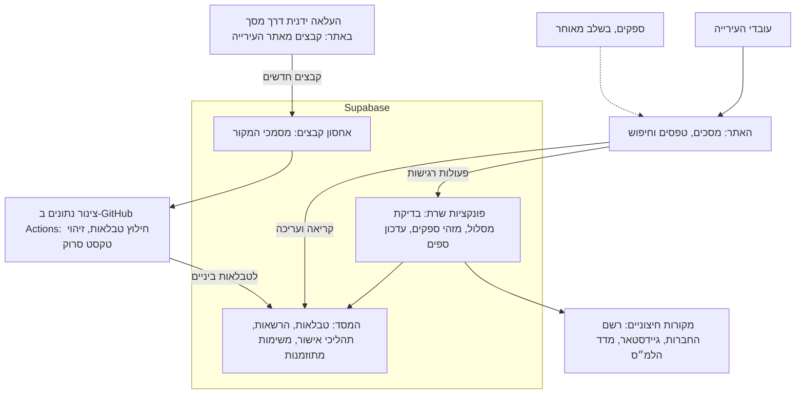

# תוכנית ארכיטקטורה וסדר לפרויקט

נכתב ב-13.11.2026, מול `main` אחרי #26 ומול בקשות המיזוג הפתוחות (#20, #25, #27, #28).
זו תוכנית בלבד. שום דבר בה לא בוצע, ואין בה מיזוג, פריסה או שינוי במסד החי.
חמש ההחלטות שבסופה התקבלו ב-13.11.2026 ומתועדות ב-`documentation/decisions/`.
גרסה מעוצבת עם תרשימים: https://claude.ai/artifact/QbpURrCoL7CvgmTg1e1cpF

## ההמלצה בקצרה

לא צריך לבנות שרת חדש. Supabase נשאר השרת של המערכת, ומוסיפים לו שלושה דברים שחסרים היום: פונקציות שרת מסודרות, משימות מתוזמנות, וצינור נפרד לעיבוד מסמכים כבדים.

- **רוב מה ש"צריך שרת" נכנס ל-Supabase.** בדיקת מסלול, חיפוש מזהי ספקים, עדכון ספים חודשי והגבלת שימוש הם פונקציות קצרות. הן רצות ב-Edge Functions ובמסד עצמו.
- **OCR וחילוץ מסמכים לא נכנסים לשם.** אלה עבודות ארוכות וכבדות. הן ירוצו כצינור נתונים ב-GitHub Actions, ויכתבו לטבלאות ביניים שממתינות לבדיקה אנושית.
- **אתר העירייה הוא החריג.** הוא חוסם גישה מהענן, ולכן אין משיכה אוטומטית ממנו. את הקבצים מעלים ידנית לאתר שלנו, כמו היום: קישור פותח את הקובץ ואפשר לחפש בו. מחשב מקומי אינו חלק מהמערכת.
- **באתר עוברים לקומפוננטות אמיתיות** לפני שבונים את מסכי הניהול. היום הממשק נבנה ידנית, וזה לא יחזיק כשיתווספו טפסים ותהליכים.
- **מוסיפים סביבת בדיקה ופריסה מבוקרת.** היום יש רק מסד חי אחד, ושינויים מוחלים בו ידנית.

## מצב קיים

היסוד בריא: מסד נתונים מסודר עם הרשאות, אתר ב-TypeScript וכללי קוד שנאכפים ב-CI. מה שחסר הוא שכבת השרת, סביבות העבודה וניקיון של שאריות.

**מה קיים ועובד**

- 18 מיגרציות וכ-25 טבלאות, עם RLS ובדיקות לכל תפקיד. הוחלו על המסד החי.
- אתר ב-TypeScript (כ-2,000 שורות, בלי הטיפוסים שנוצרים אוטומטית), נבנה ב-Vite ומוגש ב-GitHub Pages.
- מנוע הכללים ב-TypeScript, מחשבון ספים במסד, וכלי אחד לחיפוש מזהי ספקים.

**מה לא מסודר**

| נושא | המצב היום | למה זה מפריע |
| --- | --- | --- |
| שכבת שרת | פונקציה אחת (`identifier-feasibility`), מוזגה אבל לא פרוסה. מנוע הכללים לא מחובר לשום נקודת קצה | אין תבנית אחידה להרשאה, הגבלת שימוש, שגיאות וסודות. כל פונקציה חדשה תמציא אותן מחדש |
| סביבות | מסד חי אחד. אין `supabase/config.toml`, אין סביבת בדיקה, אין `.env.example` | כל שינוי נבדק לראשונה מול נתונים אמיתיים |
| פריסה | מיגרציות מוחלות ידנית. תוצר האתר (`docs/`) שמור בתוך הריפו | אין תיעוד אוטומטי של מה הוחל ומתי. כל שינוי באתר יוצר גם שינוי בקבצים בנויים, וזה מקור להתנגשויות בין ענפים |
| ממשק | בניית DOM ידנית, בלי קומפוננטות, בלי ניתוב בין מסכים. לקוח הנתונים כתוב ביד | מתאים למסך חיפוש אחד. לא מתאים למסכי ניהול, טפסים ותהליכי אישור |
| שאריות | אב הטיפוס המקומי (`app.py`, `procurement/`, `schema.sql`, `seed.sql`, `procurement_*.sql`, `index.html` בשורש) וחמישה קובצי `directory-*.js` ישנים | שתי גרסאות של אותו מנוע, וקוד שסוכן עלול להרחיב בטעות |
| בדיקות | מפוזרות בשלושה מקומות: `tests/`, `supabase/tests/`, `supabase/functions/tests/` | קשה לדעת איפה בדיקה חדשה צריכה לשבת |
| תיעוד החלטות | כללי הקוד דורשים `documentation/decisions/`, והתיקייה לא קיימת. ה-README מתאר מצב ישן | שני סוכנים (Claude ו-Codex) עובדים בלי מקור אחד להחלטות הארכיטקטוניות |

## מה דורש שרת ומה לא

יש ארבעה מקומות שקוד יכול לרוץ בהם, וכל יכולת משובצת לפי שלוש שאלות: האם יש בה סוד, האם אסור שהמשתמש יוכל לזייף את התוצאה, והאם היא ארוכה או כבדה.

| יכולת | איפה תרוץ | למה שם | מצב |
| --- | --- | --- | --- |
| חיפוש וסינון ספקים, עריכה | האתר, ישירות מול המסד | ה-RLS במסד אוכף את ההרשאות. אין צורך בשכבה נוספת | קיים |
| הרשאות, תהליכי אישור, יומן ביקורת, חישוב ספים | המסד (RLS ופונקציות SQL) | צריך להיאכף במקום אחד שאי אפשר לעקוף | קיים |
| בדיקת מסלול התקשרות | Edge Function (`route-check`) | הספים נקראים מהמסד והתוצאה נשמרת עם זהות הבודק. תוצאה שחושבה בדפדפן אינה ראיה | המנוע כתוב. נקודת הקצה חסרה |
| חיפוש מזהה ספק ברשם החברות ובגיידסטאר | Edge Function (`supplier-identifiers`) | פרטי ההתחברות לגיידסטאר הם סוד ואסור שיגיעו לדפדפן | קיים כניסוי, לא פרוס. חסרות הגבלת שימוש ושמירה רק אחרי אישור ידני |
| הגבלת שימוש | טבלת מונים במסד ופונקציה משותפת אחת | בהיקף הזה אין צורך בשירות נוסף | חסר |
| עדכון ספים חודשי לפי מדד הלמ״ס | משימה מתוזמנת במסד שקוראת ל-Edge Function | רץ פעם בחודש, בלי אדם. השורה נכנסת כהצעה וממתינה לאישור | המחשבון קיים. התזמון חסר. צריך לוודא שהלמ״ס נגיש משם |
| רענון תקופתי של סטטוס ספקים ברשמים | אותה משימה מתוזמנת | אותו מנגנון | עתידי |
| חילוץ טבלאות מ-PDF ו-Excel | צינור נתונים (Python ב-GitHub Actions) | עבודה ארוכה שדורשת ספריות Python. Edge Functions מוגבלות בזמן ריצה ובזיכרון | קיים כסקריפטים מקומיים |
| OCR לדוחות ועדת הפטור (כ-50 דוחות סרוקים) | אותו צינור | כנ״ל, וגם דורש מנוע OCR חיצוני עם מפתח סודי | חסר |
| העלאת קבצים מאתר העירייה | העלאה ידנית דרך מסך באתר, לאחסון של Supabase | אתר העירייה חוסם גישה מהענן. העלאה ידנית מספיקה, ואין תלות במחשב מסוים | הקבצים נאספים היום ידנית. מסך ההעלאה חסר |
| בדיקה אנושית של נתונים שיובאו | מסך באתר, מול טבלאות הביניים | אין כאן סוד ואין עבודה כבדה | הטבלאות קיימות. המסך חסר |
| צ׳אט על תוכן המאגרים | Edge Function שפונה למודל שפה | מפתח ה-API הוא סוד, והתשובות צריכות לכבד את הרשאות המשתמש | עתידי |

הנחה אחת שעוד לא נבדקה: שה-API של הלמ״ס נגיש מ-Edge Function (עד היום הוא נקרא רק דרך Chrome). היא תיבדק בניסוי קצר לפני שבונים עליה.

## הארכיטקטורה המוצעת

Supabase נשאר השרת היחיד של המערכת, וכל חלק אחר מדבר רק איתו. האתר לא פונה ישירות למקורות חיצוניים, והצינור לא כותב ישירות לטבלאות האמיתיות.



האתר קורא ועורך ישירות מול המסד, וההרשאות נאכפות שם. פעולה שיש בה סוד או שאסור לזייף עוברת דרך פונקציית שרת. קבצים מאתר העירייה מועלים ידנית דרך מסך באתר שלנו, כי אתר העירייה חוסם גישה מהענן. הצינור מעבד אותם וכותב לטבלאות ביניים, ורשומה נכנסת למערכת רק אחרי אישור אנושי.

חלקים חדשים או מורחבים בתוכנית: פונקציות השרת, אחסון הקבצים, צינור הנתונים ומסך העלאת הקבצים.

## מבנה הריפו והקומפוננטות

הריפו מתחלק לארבעה חלקים שכל אחד מהם נפרס בנפרד: האתר, Supabase, צינור הנתונים והתיעוד. זה המבנה שאליו מגיעים בהדרגה, ולא בשינוי אחד גדול.

```text
web/                        the site
  src/
    app/                    startup, routing, session
    features/               one folder per screen area
      suppliers/            search, details, editing
      registries/           pools, fields, categories
      route-check/          engagement route wizard
      imports/              upload of source files, review of imported data
      admin/                users, roles, thresholds
    ui/                     shared building blocks: button, table, dialog, form field
    data/                   Supabase client, queries, generated types
supabase/
  migrations/               the only source of schema, RLS and SQL functions
  functions/
    _shared/
      procurement/          rules engine (pure logic)
      identifiers/          registrar and GuideStar clients
      http/                 caller check, rate limit, input parsing, errors
    route-check/            endpoint
    supplier-identifiers/   endpoint (today: identifier-feasibility)
    scheduled/              monthly index, periodic refresh
  tests/
pipeline/                   Python, batch only (today: scripts/)
  ingest/                   pick up files uploaded through the site
  extract/                  PDF and Excel tables
  ocr/                      scanned committee reports
  load/                     write to staging tables only
documentation/
  decisions/                one short file per architectural decision
.github/workflows/          tests, deploy-web, deploy-supabase, pipeline
```

**כללי החלוקה**

- **לוגיקה עסקית חיה במקום אחד.** כללי התקנות נמצאים ב-`_shared/` כקוד טהור, והאתר ונקודות הקצה מייבאים אותם משם. אין העתקה של כלל לתוך מסך.
- **נקודת קצה היא דקה.** היא בודקת מי קורא, בודקת מכסה, מפרשת קלט, קוראת ללוגיקה ומחזירה תשובה. ארבעת הצעדים הראשונים משותפים לכל הפונקציות ונכתבים פעם אחת ב-`_shared/http/`.
- **מסך הוא תיקייה.** כל תיקייה ב-`features/` מחזיקה את הקומפוננטות, השאילתות והבדיקות של אזור אחד. מסך לא מייבא ממסך אחר, רק מ-`ui/` ומ-`data/`.
- **הצינור לא כותב לטבלאות האמיתיות.** הוא כותב רק ל-`import_batches` ול-`import_rows`, עם קישור למסמך המקור ולעמוד. רשומה נכנסת למערכת רק אחרי אישור אנושי.
- **בדיקה יושבת ליד הקוד שהיא בודקת.** תיקיית `tests/` הכללית מתפרקת לתוך `web/`, `supabase/` ו-`pipeline/`.

מה נמחק: אב הטיפוס המקומי (`app.py`, `procurement/`, `schema.sql`, `seed.sql`, `procurement_*.sql`, `index.html` בשורש), תיקיית `docs/` אחרי שהפריסה תעבור ל-GitHub Actions, וקובצי `directory-*.js` אחרי שיועברו ל-TypeScript.

## טכנולוגיות

העיקרון: לא מחליפים את מה שעובד, ומוסיפים רק מה שפותר בעיה שכבר קיימת. כל תוספת כאן דורשת החלטה מתועדת, כי כללי הקוד אוסרים היום מסגרת או שרת נוסף בלי החלטה כזו.

| שכבה | נשאר | מתווסף | למה |
| --- | --- | --- | --- |
| מסד נתונים | Supabase Postgres, מיגרציות SQL, RLS | תזמון במסד (`pg_cron`), אחסון קבצים (Storage) למסמכי המקור, טבלת מונים להגבלת שימוש, טבלת רישום לריצות של משימות | הכול בתוך השירות שכבר בשימוש, בלי ספק נוסף |
| שרת | Edge Functions ב-TypeScript | שכבה משותפת `_shared/http`, וספריית אימות קלט אחת (Zod) שמשמשת גם את האתר | אותן בדיקות קלט בדפדפן ובשרת, בלי לכתוב אותן פעמיים |
| אתר | Vite, TypeScript קפדני | React, הלקוח הרשמי `supabase-js` במקום הלקוח שכתוב ביד, וניתוב בין מסכים | קומפוננטות, טפסים ומצבי טעינה ושגיאה בלי לבנות אותם ידנית. React הוא הנפוץ ביותר, ולכן גם Claude וגם Codex כותבים בו הכי טוב |
| רכיבי ממשק | CSS קיים | תיקיית `ui/` שלנו מעל רכיבי HTML רגילים. ספרייה חיצונית רק כשיתעורר צורך | עברית וימין לשמאל עובדים הכי טוב עם HTML רגיל. פחות תלויות לתחזק |
| צינור נתונים | Python 3.12, pdfplumber, Ruff | ריצה ב-GitHub Actions, ומנוע OCR שייבחר בניסוי על שלושה דוחות | Python נשאר רק כאן, כפי שכבר הוחלט |
| בדיקות | `node --test`, PGlite, unittest | מעט בדיקות קצה לקצה בדפדפן (Playwright) מול Supabase מקומי | לוודא שהתחברות, חיפוש ושמירה עובדים יחד לפני פריסה |
| סביבות | הפרויקט החי | Supabase CLI עם `config.toml`, סביבה מקומית, ופרויקט Supabase שני כסביבת בדיקה | שינוי נבדק על נתוני דמה לפני שהוא נוגע במסד החי |
| פריסה | GitHub Pages, GitHub Actions לבדיקות | שני תהליכי פריסה ב-Actions (אתר, Supabase) שעוצרים ומחכים לאישור בלחיצה | האישור נשאר תנאי, אבל ההחלה עצמה אחידה ומתועדת. `docs/` יוצא מהריפו |
| סודות | מפתח ציבורי בלבד בדפדפן | סודות של Supabase לפונקציות, סודות של GitHub לצינור, וקובץ `.env.example` בלי ערכים | רשימה אחת של כל מה שצריך להגדיר |

**מה לא מוסיפים, ולמה**

- **שרת Node נפרד (Express, Nest) או Next.js.** אין יכולת ברשימה שדורשת אותו. הוא היה מוסיף אירוח, עלות ושכבת הרשאות שנייה שצריך לשמור מתואמת עם ה-RLS.
- **תור עבודות, Redis או Docker באירוח.** העבודות הכבדות הן מסמכים בודדים בחודש (כ-50 דוחות ועדה מאז מרץ 2024), לא אלפים ביום. GitHub Actions מספיק.
- **ORM.** הטיפוסים נוצרים אוטומטית מהמיגרציות, וההרשאות חיות במסד.

מתי לחשוב מחדש: אם תידרש עבודה כבדה שמשתמש מחכה לה מול המסך (למשל OCR מיידי לקובץ שהועלה), או אם ההעלאה הידנית תהפוך לעומס. במקרים האלה מוסיפים שירות קטן אחד, ולא מערכת שלמה.

## מפת דרכים

חמישה שלבים, כל אחד עם תנאי מעבר ברור. אין כאן תאריכים: הסדר והתנאים קובעים, והערכת זמן תינתן כשכל שלב יפורק למשימות. שלבים 2 ו-3 יכולים לרוץ במקביל, אחד אצל Claude ואחד אצל Codex. שלב 5 דורש תכנון נפרד.

| שלב | מה כולל | תנאי מעבר | תלוי ב- |
| --- | --- | --- | --- |
| 1. יסודות | מחיקת אב הטיפוס והקבצים הישנים. הוצאת `docs/` מהריפו ופריסת האתר דרך Actions. `config.toml`, סביבה מקומית וסביבת בדיקה. תהליך פריסה ל-Supabase עם אישור. `.env.example`, תיקיית החלטות ו-README מעודכן | מיגרציה חדשה מגיעה למסד החי רק דרך תהליך הפריסה, אחרי שעברה בסביבת הבדיקה | החלטות 2 ו-3. מיזוג או סגירה של #25, #27, #28 |
| 2. שכבת שרת | `_shared/http` (זיהוי הקורא, מכסה, שגיאות). `route-check`. `supplier-identifiers` עם הגבלת שימוש ואישור ידני. משימה מתוזמנת לספים. טבלת רישום ריצות | הפונקציות פרוסות בסביבת הבדיקה עם בדיקות לכל תפקיד. שורת הסף החודשית נוצרת לבד וממתינה לאישור | שלב 1 |
| 3. ממשק | React, תיקיית `ui/` וניתוב. העברת המסכים הקיימים. מסכי ניהול (משתמשים, קטגוריות, ספים). אשף בדיקת מסלול. בדיקות קצה לקצה | כל הממשק בנוי מקומפוננטות, וקובצי `directory-*.js` נמחקו | החלטה 1. שלב 1 |
| 4. צינור נתונים | אחסון למסמכי המקור ומסך העלאה ידנית. ניסוי OCR ובחירת מנוע. צינור ב-Actions. חמשת פערי הסכמה שתועדו ב-`data-sources-he.md`. מסך בדיקת ייבוא | כל דוחות ועדת הפטור בטבלאות הביניים. כל רשומה מקושרת למסמך ולעמוד, ורשומה שלא נבדקה מסומנת כלא מאומתת | החלטות 4 ו-5. שלבים 2 ו-3 |
| 5. פתיחה לספקים | תפקיד ספק והרשאות. פורטל נפרד. דומיין ואירוח. ניטור, גיבוי ותוכנית Supabase מתאימה | ייקבע בתכנון נפרד | שלבים 1 עד 4 |

התוכנית לא מחליפה את [אפיון המשימות](https://claude.ai/artifact/FtpH15XE7o6dDyQby14izV), אלא נותנת לו מסגרת. משימות הספים, בדיקת המסלול והמזהים שם נכנסות לשלב 2, מסכי הניהול לשלב 3, נתוני העירייה לשלב 4, והניקיון לשלב 1.

## החלטות

חמש ההחלטות התקבלו ב-13.11.2026. ארבע אושרו כפי שהומלץ, והחמישית שונתה: בלי אוסף על מחשב מקומי.

| # | ההחלטה | ההמלצה | מה זה מחייב |
| --- | --- | --- | --- |
| 1 | האם להעביר את האתר ל-React | כן, לפני שבונים מסכי ניהול | העברה הדרגתית של המסכים הקיימים, מסך אחרי מסך. החלופה היא להישאר בלי מסגרת ולבנות רכיבים ביד |
| 2 | האם לפתוח פרויקט Supabase שני כסביבת בדיקה | כן | לבדוק שהתוכנית הנוכחית מאפשרת פרויקט נוסף בלי תשלום |
| 3 | האם הפריסה תעבור ל-GitHub Actions עם אישור בלחיצה | כן | הגדרה חד פעמית של סודות ב-GitHub. מאותו רגע, החלה על המסד החי נעשית רק משם |
| 4 | האם מותר להשתמש בשירות OCR חיצוני בתשלום | להחליט אחרי ניסוי על שלושה דוחות, לפי דיוק הסכומים ומספרי הבקשות | הדוחות פומביים, אבל הם יישלחו לספק חיצוני, ותהיה עלות לכל עמוד |
| 5 | איך אוספים קבצים מאתר העירייה | הוחלט אחרת: העלאה ידנית דרך האתר, כמו היום | מסך העלאה באתר. לכל קובץ קישור שפותח אותו, ואפשר לחפש בו |

כל החלטה כתובה כקובץ קצר ב-`documentation/decisions/`, כללי הקוד עודכנו בהתאם, וכל שלב מתפרק למשימות של בקשת מיזוג אחת, בתיאום עם Codex.
